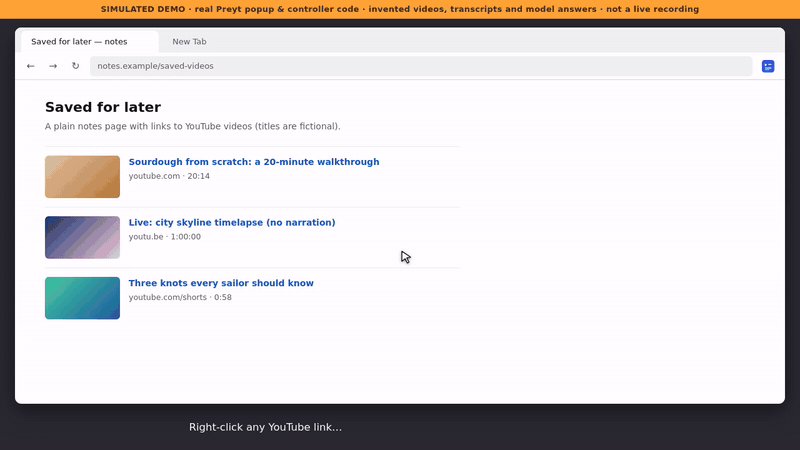

# Preyt

Right-click a YouTube link in **Firefox or Zen** → **Summarize YouTube video** → get a short summary with clickable, timestamped key points. Powered by Google Gemini with your own (free) API key.



<sub>Demo with simulated data · [MP4 version](demo/out/preyt-showcase.mp4)</sub>

## Install

1. Download `preyt-0.2.0.xpi` from [Releases](../../releases/latest).
2. In Firefox/Zen open `about:debugging#/runtime/this-firefox` → **Load Temporary Add-on…** → pick the `.xpi`.
   It stays until the browser restarts (unsigned add-ons can't be installed permanently).
3. Get a free API key at [aistudio.google.com/apikey](https://aistudio.google.com/apikey).
4. Open the add-on's **Options**, paste the key, click **Test key**.

## Privacy

The transcript, title and channel are sent directly from your browser to Google's Gemini API. There is no other server. With a free-tier key, Google may use this data to improve its products. Your key is stored only in your browser profile.

## Development

```sh
npm test        # tests
npm run build   # dist/preyt-<version>.xpi
```

MIT licensed.
